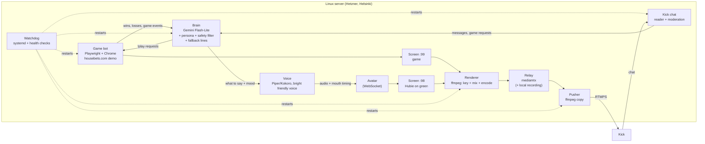

# Hubie, live 24/7

An AI-run Kick stream of **Hubie**, the Housebets sloth. Hubie plays Housebets games in **demo mode only**, hypes up and banters with chat like a real streamer, and keeps himself on air with no human touching anything.

Entry for the Housebets Contest Labs "Hubie, live 24/7" contest. Channel: [kick.com/iamhubie](https://kick.com/iamhubie)

> Status: server + Cloudflare check ✅ · avatar ✅ · persona ✅ · login/demo test and stream test 🧪 in progress · game bot, brain, voice, chat ⏳

## How it works



Why the relay: if Kick drops the connection, only the small **pusher** restarts (about 2 s). The game, avatar and encoder never stop.

## Setup (one page, works from a phone)

1. **Server:** Hetzner Cloud → Helsinki → Ubuntu → CPX32 (4 vCPU / 8 GB). Avoid US/Germany locations, where casino content is restricted.
2. **Log in:** in Hetzner, server → Rescue → *Reset root password*. SSH in as `root` (e.g. Termius on a phone).
3. **Install everything** (one line):
   ```
   curl -fsSL https://raw.githubusercontent.com/Redoxwork/Hubie/main/server/setup.sh | bash
   ```
   Wait for `SETUP-OK`.
4. **Add logins and keys** (saved to `/etc/hubie.env` on the server, never in this repo):
   ```
   hubie secrets
   ```
   Housebets email/password for Hubie's own account (no deposit, demo only), plus the Kick Stream URL and Stream Key.
5. **Test:**
   ```
   hubie test-login     # logs in, opens dice + a slot, switches to demo, takes screenshots (never bets)
   hubie shots          # view the screenshots on your phone at http://SERVER_IP:8080/
   hubie test-stream 6  # 6-minute stream to Kick; cuts the Kick link halfway to prove it reconnects
   hubie log            # watch the stream test live
   ```

## Commands

| Command | What it does |
|---|---|
| `hubie secrets` | Save or update Housebets login + Kick key |
| `hubie test-login` | Login + demo recon with screenshots |
| `hubie shots` | Serve the latest screenshots on port 8080 for 10 min |
| `hubie test-stream [min]` | Stream test to Kick with a forced reconnect |
| `hubie log` / `hubie stop` | Follow / stop the stream test |
| `hubie update` | Pull the latest code |

## Safety

- **Demo play only.** Hubie's Housebets account never holds a deposit, so a real-money bet is impossible even by accident. The bot never clicks deposit, buy, bonus-buy or cashier.
- The persona (`brain/persona.md`) never promises wins, never encourages chasing, shares Housebets' responsible-gambling view about once an hour, and points struggling viewers to support. 18+.
- Chat can request games, but can never change stakes, speed or anything money-related. Prompt-injection attempts get "not today man."

## Stack

| Part | Tool |
|---|---|
| Server | Hetzner Cloud CPX32, Ubuntu, Helsinki |
| Browser automation | Google Chrome + Playwright (playwright-core), Xvfb virtual screens |
| Avatar | Custom canvas rig from 9 frames of the official Hubie art (`avatar/`) |
| Brain | Gemini Flash-Lite + persona prompt + rule-based safety filter |
| Voice | Piper / Kokoro TTS (bright, friendly) |
| Video | ffmpeg (x11grab, colorkey, x264) → mediamtx relay → ffmpeg RTMPS to Kick |
| Chat | Kick chat API (read, reply, moderation) |
| Uptime | systemd services + watchdog |

## Repo layout

```
avatar/   Hubie avatar engine (hubie-avatar-demo.html = standalone; ?overlay=1&keyed=1 = stream mode)
brain/    persona.md, the system prompt for Hubie's brain
server/   setup.sh, the hubie command, tests, stream pipeline
tools/    scripts that built the avatar rig from the source frames
```

## Rebuild the avatar rig

```
python3 tools/align.py avatar/src avatar/src/aligned
python3 tools/build_rig.py avatar/src/aligned avatar/rig
python3 tools/bundle.py avatar
```

Avatar control over WebSocket (page opened with `?ws=ws://host:port`):
`{"type":"say","text":"..."}` · `{"type":"speak","url":"/tts/1.wav","text":"..."}` · `{"type":"react","mood":"win|bigwin|loss|shock|think|look"}` · `{"type":"layout","mode":"cam|full"}`
